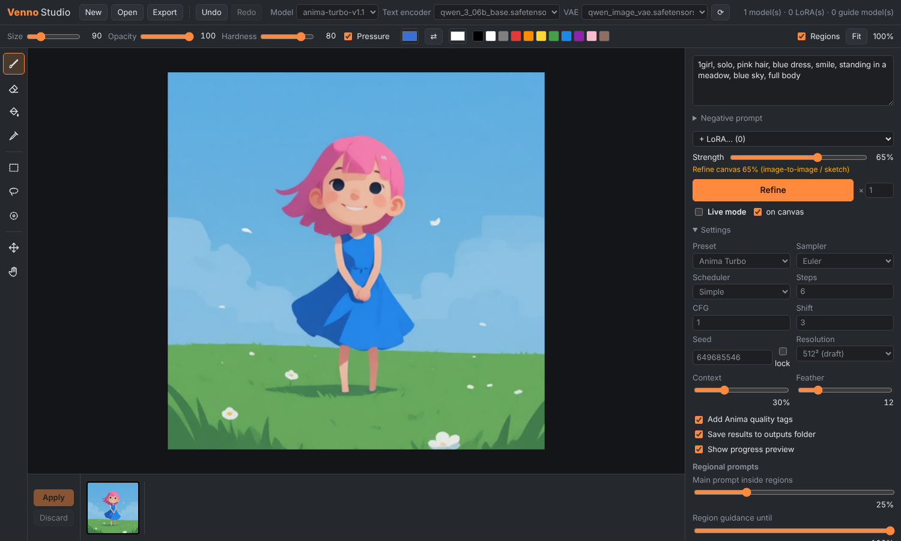

# Venno Diffusion UI

A painting-first UI for the **[Anima](https://huggingface.co/circlestone-labs/Anima)** image model, in the spirit of Krita AI Diffusion. You sketch, select and paint on a layered canvas. The model then generates, refines or inpaints exactly the part you point it at.

The generation engine is **[Stable Diffusion WebUI Forge – Neo](https://github.com/Haoming02/sd-webui-forge-classic/tree/neo)** by Haoming02, cut down to Anima only. Its memory management, samplers, LoRA support and API are kept. Forge's Gradio interface is removed. Venno Studio is the only front end, with these tabs:

- **Canvas**: the layered painting workspace.
- **Text to Image**, **Image to Image** and **Inpaint**: classic form-style generation, with hires fix, ADetailer, comparison grids and a results gallery. Image to Image and Inpaint show the input (and mask) large, next to the result.
- **Image Info**: drop any image to read its generation parameters and send them (with the image) to another tab.
- **Models**: one-click downloads of Anima, guide (ControlLLLite) models, upscalers and detectors.



## Features

| | |
|---|---|
| **Sketch → image** | Draw on any paint layer with pressure-sensitive brushes, fill and eraser, then **Refine** at 40–80 % strength. Composition and colours from the sketch are kept. |
| **Sketch guides** | *Guide* layers steer generation through **Anima ControlLLLite** models (line art, scribble, depth, pose…) instead of being painted into the image, so loose line art shapes the result even at 100 % strength. Start/end are real steps, and guides also steer the hires pass. |
| **Inpainting** | Select an area with the rectangle, lasso or selection brush and press **Generate**. Only the selection changes. Venno adds surrounding context automatically, feathers the edges, and uses Forge's soft inpainting for seamless blends. |
| **Image to image** | Open, paste or drag in an image and refine the whole canvas or just a selection at any strength. |
| **Regional prompting** | *Region* layers are painted masks, each with its own prompt (e.g. one character per region). Each region's prompt steers its own area inside the model's text attention at every step, alongside the main prompt, with any sampler or LoRA, at roughly the cost of a single prompt. Inpainting works with regions too. |
| **Prompted sketch layers** | Give any paint or guide layer its own prompt and its strokes become a region. Venno grows the strokes and fills closed outlines, so sketching a figure on its own layer is enough to prompt it separately. |
| **Prompt scheduling** | Forge/A1111 syntax works as-is (`[a:b:0.4]`, `[a:0.5]`, `[a::0.5]`, `[a\|b]`, `AND`, also in region prompts), and a preview line under the prompt says what happens at which step. For the common case, *Then switch to…* takes a second prompt and a slider: composition from the first prompt, details from the second. |
| **Tag autocomplete** | Every prompt box suggests Danbooru tags (140k, with post counts and aliases) while you type, inserted the way Anima wants them: lowercase with spaces, `@artist`, escaped parentheses. `@` lists artists only, `__` lists wildcard files. ↑/↓ and Enter/Tab; extra tag lists can go in `tags/*.csv`. |
| **Wildcards** | `{red\|blue\|green} hair`, `{2$$a\|b\|c}`, `{0.2::rare\|common}` and `__file__` (lines from `wildcards/file.txt`, nested folders and `*` allowed). Each image picks from its own seed, so results are reproducible; the template is kept in the image metadata. |
| **Settings from images** | Drop a PNG from Venno, Forge or A1111 (or an A1111 JPEG/WebP) onto a tab, or press *From image…*, to load its prompt, LoRAs, seed, sampler, size, hires, switch prompt and detailer settings. Opening such an image on the Canvas offers the same. Results have a *Use settings* button. |
| **Comparison grid (X/Y/Z)** | Text to Image / Image to Image: up to three axes over artist, prompt S/R, CFG, steps, shift, seed, sampler, scheduler, checkpoint, LoRA weight, denoising, hires upscaler, size, switch point and detailer denoise. A1111 value syntax (`1-5`, `1-10 (+2)`, `0.5-1.5 [5]`), a live cell count, labelled grid images (one per Z value) saved to `outputs/txt2img-grids`. |
| **LoRAs** | Picked LoRAs appear as chips under the prompts instead of `<lora:…>` text. Click a chip to remove it; edit or scroll its number to change the weight (0 = off). Pasted `<lora:name:weight>` tags turn into chips automatically. LoRAs made for a smaller Anima are re-mapped onto larger ones (e.g. 2B → 2.9B). |
| **ADetailer** | On by default (except live mode). Detects faces (and optionally hands / people) with ADetailer's YOLO / mediapipe models and re-renders each at a resolution suited to its size, blended in seamlessly. Several faces are refined in one batched pass; when inpainting, only faces inside the selection are touched. `<lora:…>` in a detailer prompt applies to the detailer only. |
| **Hires. fix** | Text to Image: generate, upscale (latent, Lanczos or any ESRGAN/DAT/SwinIR-style model via Spandrel), refine. Upscale factor or target size, separate steps, denoising, CFG and shift. LoRAs, regions, guides and prompt scheduling all carry into the second pass. |
| **Live mode** | Re-generates automatically after each stroke (fixed seed, so changes stay comparable). Works best with **Anima Turbo** and the 512²/768² resolutions. |
| **Layers & history** | Paint / region / guide layers, opacity, visibility, reorder, duplicate, merge down, undo/redo for everything, export to PNG. |
| **Results tray** | Every generation lands in a tray. Preview a result on the canvas, then **Apply** it as a new layer (it is never baked in automatically). |

## Install

1. Install [git](https://git-scm.com/downloads) and [uv](https://github.com/astral-sh/uv#installation) (recommended) or Python 3.13.
2. Clone and create a venv:
   ```bash
   git clone https://github.com/LordVennin/Venno-Diffusion-UI
   cd Venno-Diffusion-UI
   uv venv venv --python 3.13 --seed
   ```
3. Run `webui-user.bat` (Windows) or `./webui-user.sh` (Linux/macOS). The first start installs dependencies, then Studio opens at **http://127.0.0.1:7860/**.
4. With no Anima checkpoint installed, Studio opens on the **Models** tab. Download *Anima Turbo* (or Aesthetic/Base), the *Qwen3 text encoder* and the *Qwen-Image VAE*, plus any guides and upscalers you want. *Download from URL* takes any Hugging Face / Civitai / direct link (LoRAs too). You can also place files manually:

   | File | Folder |
   |---|---|
   | `anima-turbo-v1.1.safetensors` (or `anima-aesthetic-…`, `anima-base-…`) | `models/Stable-diffusion/` |
   | `qwen_3_06b_base.safetensors` | `models/text_encoder/` |
   | `qwen_image_vae.safetensors` | `models/VAE/` |
   | *(optional)* LoRAs | `models/Lora/` |
   | *(optional)* Anima ControlLLLite guide models, e.g. [`anima-lllite-any-test-like-v2`](https://huggingface.co/kohya-ss/Anima-LLLite) (line art / scribble / grayscale) | `models/ControlNet/` |
   | *(optional)* upscalers (`.pth` / `.safetensors`) | `models/ESRGAN/` |

The text encoder and VAE are picked automatically in the top bar. Choosing a checkpoint with `turbo` in its name switches to the Turbo preset (Euler · Simple · 10 steps · CFG 1). Other checkpoints get the model card's settings (ER SDE · Beta · 32 steps · CFG 4). Both use shift 3.

Only Anima checkpoints are accepted. Loading any other architecture fails with a clear error.

Forge's [command-line flags](docs/FORGE_NEO_README.md#commandline) still apply, e.g. `--uv`, `--sage`, `--listen`, `--port`, `--ckpt-dirs`. With `--listen`, downloading from custom URLs is disabled unless you add `--enable-insecure-extension-access`. Catalog downloads keep working.

## Using the Studio

**The one rule:** *selection decides where, strength decides how much.*

| Selection | Strength | What happens |
|---|---|---|
| none | 100 % | **Generate** a new image at the canvas aspect ratio |
| none | < 100 % | **Refine** the whole canvas (img2img / sketch → image) |
| yes | 100 % | **Generate inside the selection** (inpaint) |
| yes | < 100 % | **Refine the selection** (partial inpaint) |

Results are rendered at about the chosen *Resolution* (default 1024², Anima's native size), whatever the size of the area you work on. A small selection is upscaled for detail and the result scaled back in.

### Regions

The **Regions** list under the prompt shows every region with its prompt. *+ Region* adds one and picks the **Rectangle tool (U)**: drag boxes where it applies (or paint with the brush; Ctrl+drag erases a box). *Area* reselects a region's layer to edit it, the eye turns it off. LoRAs apply to the whole image, not to a single region.

Where regions overlap, the **higher layer wins** by default: a region covers the ones below it, with a soft edge. So a background region filling the whole canvas with a character region on a layer above gives the character's prompt the character's area, and the background prompt everywhere else. The *Regions* overlay shows exactly this. Set *Overlapping regions* (in the region settings) to *Blend prompts* to mix overlapping prompts instead, for example to add a detail on top of a character.

Each region can also have its own **negative prompt**: open *Negative* under its prompt (or use *Region negative* in the layer panel). It applies only inside that region, and the main negative is added to it, so it only needs what is specific to that area: `blonde hair` for the black-haired character so colours don't bleed, `hat` for one character only, or `1girl, people` on a background region to keep extra figures out of the scenery. Regions without one use the main negative. Region negatives need a negative pass: they do nothing at CFG 1 (e.g. turbo settings), and only the Venno engine uses them.

### Prompting sketch layers

Write a prompt in a paint or guide layer's *Layer prompt* field. That layer's strokes then act as a region, which is handy for "sketch each character on its own layer". *Region spread* sets how far around the strokes the prompt reaches. *Fill enclosed shapes* makes a closed outline count as its whole interior. Tick *Show region* to see the area that will be used. Paint layers stay part of the image. Guide layers with a prompt both steer the lines and prompt the area.

### Sketch guides

Add a **Guide** layer, pick a model (Venno prefers `any-test-like` / `lineart` models), and draw dark lines. The guide steers composition without being painted into the image, so it works even at 100 % strength. You can combine it with paint layers at lower strength to control colours as well. For scribble models, *Line polarity: Auto* sends white-on-black lines automatically. Lower *Guide until* if the result follows wobbly lines too literally.

### Shortcuts

| Key | Action | Key | Action |
|---|---|---|---|
| `B` | Brush | `Ctrl+Enter` | Generate / Refine |
| `E` | Eraser | `Enter` / `Esc` | Apply / discard previewed result |
| `G` | Fill | `Ctrl+Z`, `Ctrl+Shift+Z` | Undo / redo |
| `I` (or `Alt`+click) | Colour picker | `Ctrl+A`, `Ctrl+D`, `Ctrl+Shift+I` | Select all / none / invert |
| `M` / `L` / `S` | Rect / lasso / brush select | `Delete`, `Alt+Backspace` | Clear / fill selection |
| `V` | Move layer | `[` `]` | Brush size |
| `H` or `Space` drag | Pan | `X` | Swap colours |
| wheel | Zoom | `0` / `1` | Fit / 100 % |

`Shift` adds to a selection, `Alt` subtracts. Pen pressure controls brush size.

### Tips for Anima

- Danbooru-style tags, natural language, or both. Prefix artists with `@`.
- *Add Anima quality tags* prepends `masterpiece, best quality, score_7, safe, `. Turn it off for Anima-Aesthetic, whose model card advises against `score_*` tags.
- Prompt weights need to be stronger than on SDXL, e.g. `(chibi:2)`.
- Regions: describe each character fully in its region prompt. The main prompt is appended to each region (and the main negative to each region negative) by default; *Main prompt inside regions* controls how much the main prompt still shapes the regions.

## Text to Image / Image to Image

These are Forge-style form pages: prompt, negative, LoRA chips, preset/sampler/scheduler/steps/CFG/shift, size presets, batch size and count, and seed reuse.

- **Hires. fix (Text to Image):** generate small, upscale with a latent mode or an upscaler model, then refine. Set the upscale factor or a target width/height, plus separate hires steps, denoising, CFG and shift (0 = same as the first pass).
- **Image to Image / Inpaint:** drop, paste or send in an image; it is shown large next to the result. Size is *Resize by* a scale (e.g. 150 %) or *Resize to* a width/height. On **Inpaint**, paint the mask (wheel = brush size); settings include masked content, whole picture vs only masked (with padding), mask blur and seamless inpainting.
- **ADetailer:** up to two detectors (e.g. `face_yolov8n.pt` + `hand_yolov8n.pt`), each with its own denoising, confidence, mask blur, dilation, padding and optional detail prompt.
- **Results:** *Open in Canvas* adds the image as a layer; *Send to Image to Image* / *Send to Inpaint* pass it on **with the prompt, LoRAs, seed, sampler settings and ADetailer** of the tab it came from; *Use settings* loads its parameters; *Download* saves it. Results are also saved to `outputs/` unless you turn that off.
- **Option cards:** the checkbox turns hires fix / ADetailer / the grid on and off; clicking the title only opens its settings.

## API

Studio talks to the server only through the Venno API under `/venno/v1`. Every generation mode uses one job format; see `Job` in [`lib_venno/jobs.py`](extensions-builtin/venno_studio/lib_venno/jobs.py).

```jsonc
POST /venno/v1/jobs
{
  "mode": "txt2img",                     // or "img2img" (+ init_image, strength, mask, …)
  "model": { "checkpoint": "anima-turbo-v1.1.safetensors", "text_encoder": "qwen_3_06b_base.safetensors", "vae": "qwen_image_vae.safetensors" },
  "prompt": "masterpiece, best quality, safe, 1girl, …", "negative": "…",
  "width": 1024, "height": 1024, "batch": 2, "seed": -1,
  "sampler": "Euler", "scheduler": "Simple", "steps": 10, "cfg": 1.0, "shift": 3.0,
  "regions":  [{ "prompt": "…", "negative": "", "mask": "<png>" }],
  "guides":   [{ "model": "anima-lllite-any-test-like-v2", "image": "<png>", "weight": 0.8 }],
  "hires":    { "upscaler": "Latent", "scale": 1.5, "denoise": 0.5 },
  "detailer": [{ "model": "face_yolov8n.pt", "denoise": 0.4 }]
}
```

- `GET /venno/v1/jobs/{id}`: status, progress, seeds, infotexts and image URLs (`/venno/v1/jobs/{id}/images/{n}.png`)
- `POST /venno/v1/jobs/{id}/cancel`: cancel a queued or running job
- `WS /venno/v1/events`: pushes every job update plus live preview frames
- `GET /venno/v1/info`: models, modules, LoRAs, samplers, schedulers, upscalers, detectors, presets
- `/venno/v1/models/catalog`, `/download`, `/jobs`, `/cancel`: model downloads

The old A1111/Forge `/sdapi` endpoints are no longer supported and will be removed (see [`docs/PLAN_VENNO_SERVER.md`](docs/PLAN_VENNO_SERVER.md)).

## Project layout

| Path | |
|---|---|
| `extensions-builtin/venno_studio/studio/` | Studio front end (plain ES modules, no build step) |
| `extensions-builtin/venno_studio/scripts/venno_studio.py` | Serves Studio, `/venno/api/*` |
| `extensions-builtin/venno_studio/lib_venno/jobs.py` | Venno job API: schema, queue, engine adapter |
| `extensions-builtin/venno_studio/lib_venno/downloads.py` | Model catalog and downloader |
| `extensions-builtin/adetailer-neo/` | ADetailer-Neo (Haoming02, AGPL-3.0) |
| `extensions-builtin/venno_studio/scripts/venno_regional.py` | Regional prompting (masked per-region conditioning) |
| `backend/`, `modules/`, `modules_forge/` | Forge Neo engine (Anima only) |

## Credits & licence

- Engine: [Forge Neo](https://github.com/Haoming02/sd-webui-forge-classic/tree/neo) by Haoming02, based on [Forge](https://github.com/lllyasviel/stable-diffusion-webui-forge) by lllyasviel and [Stable Diffusion WebUI](https://github.com/AUTOMATIC1111/stable-diffusion-webui) by AUTOMATIC1111. The upstream README is kept in [`docs/FORGE_NEO_README.md`](docs/FORGE_NEO_README.md).
- Model: [Anima](https://huggingface.co/circlestone-labs/Anima) by CircleStone Labs & Comfy Org (non-commercial model licence; generated images may be used commercially).
- Inspired by [Krita AI Diffusion](https://github.com/Acly/krita-ai-diffusion).

Licensed under the [AGPL-3.0](LICENSE), same as the upstream projects.
